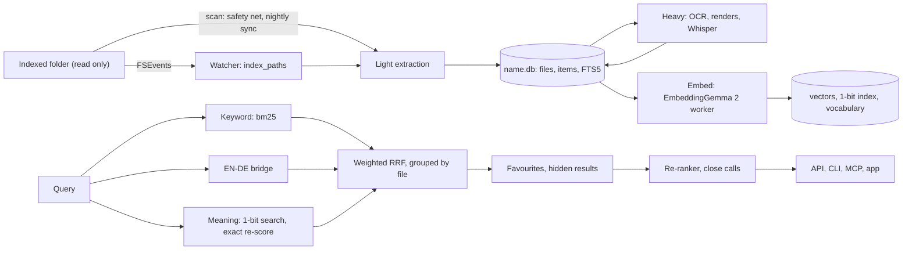

# How MySearch works

This is for engineers who want to read, run or change MySearch. Each claim names the file that implements it. For installation see [INSTALL.md](INSTALL.md); for the user's view see the [README](../README.md). Where the code is unclear, this document leaves the point out.

## 1. Architecture

| Component | Where | Role |
|---|---|---|
| Daemon | `mse/server.py` (`mse serve`) | HTTP API, web UI (`mse/ui/`), MCP over HTTP, job queue. Standard-library HTTP on 127.0.0.1, port 8737. Loads no model. |
| Model workers | `mse/worker.py`, via `mse/embedder.py` | Separate processes for embeddings, Whisper, re-ranking and Ask. |
| Native helper | `helper/msehelper.swift` | PDF text and renders, Vision OCR, FSEvents, file-name crawl, Keychain. One JSON reply per command. |
| Mac app | `app/` | Native app on the HTTP API. `MySearch --daemon` supervises the service. |
| CLI | `mse/cli.py` | Search, file names, Ask, folders, evaluation, service control. |
| MCP server | `mse/mcp.py` | JSON-RPC 2.0 for agents: stdio (`mse mcp`) and `POST /mcp`. Eight tools. |
| Raycast | `integrations/raycast/` | Search and status, using the port and token in `config.json`. |
| LaunchAgent | `mse/service.py` | Label `com.mysearch.daemon`. Starts at login, restarts on exit. |

**Access.** The Host header must name `127.0.0.1`, `localhost` or `[::1]` on the service port. `/api/*`, `/mcp` and the web pages (`/`, `/settings…`, `/?mini=1`) need the token (the `X-MSE-Token` header or a `t` query parameter), and any Origin must be local. A page without the token gets a 401 note. `/static/` is public and holds no token. The token is `secrets.token_urlsafe(24)`, stored in `config.json`. SECURITY.md has the full model.

**Processes.** A worker reads one JSON object per line on stdin and replies on stdout. `mse/embedder.py` starts it on first use and stops it after 10 idle minutes. The Ask worker stops after 5 (`ask.idle_unload_min`), or at once when Ask is switched off.

**Supervision.** With MySearch.app installed, the LaunchAgent runs `MySearch --daemon` (`app/Daemon.swift`). That supervisor starts the Python service as a child, forwards SIGTERM and SIGINT so the queue is saved, and exits with the child's status. The plist sets `HF_HUB_OFFLINE=1`, so the service cannot download models.

## 2. Indexing

| Stage | Function | Output | When |
|---|---|---|---|
| Light | `extract.light()` in `indexer.scan()` | Text, Office, mail, PDF text layer, archive names | Every scan |
| Heavy | `extract.heavy()` in `indexer.heavy()` | OCR, page renders, media segments, transcripts | Nightly; live for up to 5 new files on AC power |
| Embed | `indexer.embed()` | Vectors for text, titles, pictures, pages, video, audio | After each stage; live for up to 400 pending text items |

A sync (`mse/jobs.py`) runs scan, heavy document work, embed, heavy audio and video, and embed again. At night it adds an FTS optimise. Every sync ends by building the folder's vocabulary (`indexer.build_vocab()`), which feeds the EN↔DE bridge. A live change indexes only the files that changed.

**Formats** (`mse/extract.py`). Text and code (Markdown split by heading), Word and RTF via macOS `textutil`, spreadsheets sheet by sheet, OpenDocument, iWork, mail (`.eml`, mbox), PDF text layers, images, audio, video, and archive member names. Other files are indexed by name only. Files over `max_file_mb` (200 by default), or matching a `metadata_only` pattern, are in *meta* mode: name only, never opened or hashed.

**OCR.** A PDF page is scanned when it has under 40 non-space characters, or under 600 with text covering under 5% of the page. Scanned pages are OCRed. In the default `smart` mode, page 1 and those pages are also rendered, up to 30. Vision renders at about 300 dpi (long side at most 4,096 px), keeps observations with confidence 0.3 or more, and detects the language per image unless `media.ocr_langs` is set.

**Transcripts.** `ffmpeg` writes a 16 kHz mono WAV and cuts silences of at least 8 seconds below −40 dB, but only when the cut saves at least 60 seconds and 20%. Whisper large-v3-turbo runs once per file, with no-speech, log-probability and compression thresholds of 0.6, −1.0 and 2.4. A line repeated three times in a row is kept once. Tags, subtitle credits and sign-offs the model judged unlikely to be speech are dropped. Passages run 30 to 60 seconds. Only the first `max_media_minutes` (90 by default) are processed.

**Incremental scans** (`mse/indexer.py`).
- A file whose size, mtime and mode are unchanged is not opened.
- Reads run in two to four threads, each with a 420-second limit. Only the scanning thread writes, committing every 200 files or 2 seconds.
- A vanished row and a new file are one file when extension and size agree and the content hash matches. The row is re-pointed, keeping its text, OCR and vectors.
- A file that fails three times in a row, with the same mtime and extractor version, is skipped until one of them changes. A marker file lists the files being read, so a killed process gives each of them a strike.
- `EXTRACTOR_VERSION` names extensions whose extraction changed. Their files are re-read, 25 per scan or 2,000 at night.
- A folder the walk cannot read keeps its rows. A missing root removes nothing.

**Live updates and the night run.** `mse/watcher.py` flushes 3 seconds after the last FSEvents event, and at most 45 seconds after the first. More than 500 paths in one flush, or dropped events, trigger a full scan. A scan every 60 minutes is the safety net. The nightly sync starts at 02:30 inside a 5-hour window, on AC power by default. A run due outside the window waits for 20 minutes without input (`mse/jobs.py`). In the night run, embedding runs at nice 10 and the FTS index is optimised.

**Progress.** `GET /api/index/progress` and `mse status` report each folder's stage, counts, rate and errors (`mse/progress.py`).

## 3. Storage

Each folder has `collections/<name>.db`, an SQLite database in WAL mode with one write lock per folder (`mse/store.py`).

| Table | Holds |
|---|---|
| `files` | One row per file: path, kind, size, mtime, mode (`full` or `meta`), title, date, `docid` (the `#docid`), hash, inode, extractor version |
| `items` | Searchable pieces (text, OCR, transcript, page, picture, segment), with page, time range and `embedded` flag |
| `fts` | FTS5 over name, heading and text. Diacritic-insensitive, with a prefix index |
| `vectors`, `vbin` | float16 vectors for exact re-scoring; a sqlite-vec index of 768-bit sign vectors |
| `vcache`, `vocab`, `vvocab` | Prompt-to-vector cache; vocabulary terms and their embeddings |
| `failures`, `meta` | Strike counts; timestamps and resume checkpoints |

Search asks the 1-bit index for 16 times the list size, then re-scores those candidates exactly. With 2,000 or fewer allowed files it scores their vectors exactly, with no first pass (`EXACT_FILTER_FILES`). Other state lives in `~/Library/Application Support/MySearch/` (mode 0700). Removing a folder moves its database to `trash/`; nothing is deleted.

## 4. Search and ranking (`mse/search.py`)

**Parsing.** Known `key:value` filters (`config.FILTER_KEYS`) and quoted phrases are taken out. Plain-language dates ("last month", "invoices from March 2025") become `after` and `before` on the document date. `in:` takes a path, or a folder, group or alias name.

**Three lists**, merged by weighted reciprocal-rank fusion: each hit adds `weight / (60 + rank + 1)`.

| List | Method | Weight |
|---|---|---|
| keyword | FTS5 `bm25` (name ×4, heading ×2, text ×1); words of four letters or more match as prefixes | 0.6 |
| translated | Query embedding matched to the folder's vocabulary (cosine ≥ 0.62, at most five terms), then searched by keyword | 0.6 |
| meaning | Query vector against text (1.0), titles (0.55), pictures and pages (0.75), audio (0.6) | as shown |

Queries use the prefix `task: search result | query: `. Documents use `title: … | text: …` (`mse/embedder.py`). The top keyword and text hits get a 0.004 bonus. Filters apply inside retrieval.

**Documents.** Files sharing a long, specific name (18 or more letters and digits after folding, not a generic overview name), or else a content hash, form one document, and the best-ranked original is shown. A file's score is its best item, plus 0.3 of the second, plus 0.1 of the third. Overview files (SUMMARY, README, INDEX, TODO and similar) are multiplied by `hub_penalty`, 0.6.

**Favourites** (`mse/feedback.py`). *Best* files are pinned in the order marked, and *hide* files are removed. For a query with embedding cosine ≥ 0.90 to a stored one, *best* files already in the results get a bonus of 15 to 50% of the top score. Pinned results are never re-ranked.

**Re-ranker** (`mse/rerank.py`). It runs only on close calls, when the second result scores at least 0.8 times the first. It re-orders the top 10 with Qwen3-Reranker-0.6B, which answers yes or no for each query and document (name plus up to two passages, cut to 128 tokens). Its order is fused with the retrieval order by rank, with retrieval weighted 0.75, so it mostly breaks ties. The CLI re-ranks unless `--fast` is given. MCP `precise` defaults to true. `/api/search` re-ranks only with `precise=1`. The app and web UI show the instant list, then request `precise=1` and replace it if the order changes.

**Presentation.** `relevance` runs from 0 to 100 against the top score. Diacritics fold on both sides, so `Lösung` matches `Losung`. `doc_date` is the date in the file's path, else its modification time. Dates inside the content are never read.

## 5. Learning loop

**Tuning** (`mse/learn.py`, `mse/evaluate.py`). After each night sync, `learn` writes known-item questions from up to 150 recent files per folder, keeping those that at most two documents match. A grid over fusion weights, hub penalty, and re-ranker gate and weight is scored on the gold sets in `eval/`, the favourites and these questions (hit@1, hit@3, hit@10, MRR@10). A setting is applied only if weighted MRR rises by at least 0.01, no hand-written gold set loses more than 0.01 MRR or a rank-1 hit, and favourites do not get worse. `mse tune --rollback` undoes a change.

**Re-ranker fine-tune** (`mse/finetune.py`). It starts with at least 300 favourite examples and 100 queries. Each favourite is the positive; the hard negatives are the documents ranked just above and below it. Queries split 80/20 by a stable hash, and gold-set questions are never used. QLoRA through mlx-lm trains rank-8 adapters on the query and value projections of the last 16 layers. Promotion needs favourite MRR up by 0.02 or more, no gold set down by more than 0.01 MRR, and median re-rank time up by at most 10%. A `CURRENT` file selects the adapter, so rollback only moves that pointer.

## 6. Whole-Mac file names (`mse/macindex.py`, `mse/filequery.py`)

**Crawl and index.** The helper's `crawl` walks breadth first with `getattrlistbulk`. It never follows symbolic links, stays on the boot volume and skips iCloud placeholder folders. Python checks each entry against the privacy rules before storing it. `macindex.db` holds a `files` table, an FTS5 `trigram` table over names, and a `vocab` table of name tokens for typo candidates. The first crawl starts 20 s after the service; rescans run every 24 h; FSEvents (0.3 s latency) keeps rows current.

**Never indexed.** Credential and key stores (`~/.ssh`, `~/.gnupg`, keychains), browser profiles, Mail and Messages, system and cache folders, trash and dependency folders. These cannot be configured. Only names and sizes are stored, and `~/Library/` is excluded by default. The MCP server has no tool for this index, and the CLI refuses it under `MSE_LOCK`.

**Query language** (full text at the top of `mse/filequery.py`):

| Query | Meaning |
|---|---|
| `invoice acme` | Every word appears in the name |
| `^prefix`, `suffix$`, `^whole$` | Starts with, ends with, or is the whole name |
| `ext:pdf,docx`, `type:image`, `!ext:tmp` | Extensions, kinds, exclusions |
| `size:>5mb`, `mtime:<7d` | Size; modified within 7 days |
| `path:work/notes`, `re:^IMG_\d+` | Path contains text; regular expression on the name |
| `in:~/Documents`, `in:work` | Under a folder, or a MySearch folder or group |

**Typos and ranking.** A word of five or more letters forgives one edit: an insertion, deletion, substitution or swapped neighbours. A four-letter word forgives a swap only. Typo candidates come from `vocab` and are searched only when literal results fall short of the limit; they rank last. Ranking is exact name, prefix, word boundary, substring, typo, then coverage, recency and depth.

## 7. Ask (`mse/ask.py`, `mse/cloud.py`, `mse/providers.py`)

Ask is **off by default**. While it is off, nothing is called or loaded.

1. **Rewrite.** A follow-up becomes a standalone search question: by the cloud model (1.5-second budget) when the answer goes to the cloud, otherwise by the local model (at most 40 tokens), or by adding earlier key terms.
2. **Passages.** The precise search runs over the scope. Each top document contributes its best chunk, and spare budget adds second chunks: at most 8 passages, about 3,000 tokens, 1,200 characters each. Metadata-only files never contribute.
3. **Answer.** The model answers in at most five sentences, citing each claim as `[n]`. Citations that point to no passage are removed. If the passages hold no answer, the model replies with one fixed sentence, which is recognised as not found.

| Route | Answered by |
|---|---|
| `cloud` (default) | The chosen cloud model. An error if none is reachable, unless `local_fallback` is on |
| `local` | Qwen3-4B-Instruct-2507, 4-bit MLX. Nothing leaves the Mac |
| Folder with `ask_cloud: false` | Local, whatever the route |

Providers: `anthropic` (Claude API) and custom OpenAI-compatible endpoints (Chat Completions or Responses; fields `key_file`, `training_models`, `auto_models`, see the README). A key comes from the Keychain, else the provider's `key_file`, read when a call needs it. Reachability is a TCP connect (1.5 s timeout, cached 60 s), never an API call. Models matched by a provider's `training_models` patterns may train on inputs, so they need a one-time confirmation before they answer.

**What leaves the Mac.** With `cloud_redact` on (the default), passages and earlier turns are masked before the call, and `done.redacted` counts the masks. The question is sent as typed. Keys travel only in a request header, over https or to loopback, and redirects are refused.

## 8. Privacy and safety

| Control | Where | Effect |
|---|---|---|
| Read-only indexing | `mse/indexer.py` | The indexer and daemon never write inside an indexed folder. Writes happen only on request (`mse agents install`, app file operations and colour tags) |
| Data folder | `mse/paths.py` | Mode 0700 |
| Localhost only | `mse/server.py` | 127.0.0.1 only; Host and Origin checks; token (constant-time compare) on `/api/*`, `/mcp` and the web pages |
| Metadata-only | `mse/indexer.py` | Name only; never opened or hashed |
| Secret exclusions | `mse/ignore.py` | Env files, keys, certificates, keystores, credential-, secret- and password-named items, SSH and GPG folders. Never read or listed; not configurable |
| Default exclusions | `mse/ignore.py` | Hidden folders, build and dependency output, caches, lock and temp files, agent configs |
| Redaction | `mse/redact.py` | IBANs, passport, ID, permit, tax and social-security numbers, dates of birth and machine-readable zones, masked for agents and piped CLI output. The app shows everything |
| Keychain | `mse/providers.py`, helper | Keys under service `com.mysearch.provider`, read with UI disabled, cached 10 minutes, never in config, logs or responses |
| MCP lock | `mse/mcp.py` | `MSE_LOCK=1` (stdio only) limits a session to its folder's collection. HTTP `/mcp` takes the token but is not locked |
| Downloads | `mse/setup_models.py` | Public Hugging Face repositories at pinned revisions |

## 9. Performance

Measured on an M4 Pro, on a private test folder of a few hundred documents in English and German. Search quality: 28 questions run with `mse eval` on a gold set that is not published.

| Setting | Right file first | In top 3 | In top 10 | MRR |
|---|---|---|---|---|
| First version (equal weights) | 0.68 | 0.89 | 0.96 | 0.81 |
| Current default | 0.82 | 0.96 | 1.00 | 0.90 |
| Meaning only | 0.82 | 0.93 | 0.96 | 0.87 |
| Keywords only | 0.57 | 0.64 | 0.79 | 0.63 |
| Default + re-ranker | 0.89 | 1.00 | 1.00 | 0.95 |

Engine: 8-bit against BF16 embeddings gives cosine 0.9996 and 99.6% identical top 10. The 1-bit search with 16× re-scoring gives 99% identical top 10, about 10× faster. An unchanged folder re-embeds in 6 s instead of 320 s. Live changes show in about 3.6 s. The service uses 50–170 MB, the text model about 0.8 GB and the re-ranker about 0.9 GB while loaded. The re-ranker adds 0.25–0.45 s when it runs.

File-name index, on a synthetic index of 2.0 million entries with realistic names (M4 Pro, warm cache, not a live disk): about 5 ms p50 in process at `limit` 50, 9.4 ms p50 end to end at `limit` 200, and about 1 GB on disk.

## 10. Models

Weights are never shipped. `mse setup models` downloads them (manifest in `mse/setup_models.py`; see [INSTALL.md](INSTALL.md)).

| Role | Model | Size | Licence | Loaded when |
|---|---|---|---|---|
| Embeddings, all media | Google EmbeddingGemma 2, 8-bit MLX | 1.2 GB | Apache-2.0 | Searching; night run |
| Speech to text | Whisper large-v3-turbo, 8-bit MLX | 829 MB | MIT (OpenAI's original); the MLX repack's card says Apache-2.0 | Night run, new recordings |
| Re-ranking | Qwen3-Reranker-0.6B, 8-bit MLX | 615 MB | Apache-2.0 | Close calls |
| Ask, local | Qwen3-4B-Instruct-2507, 4-bit MLX | 2.1 GB | Apache-2.0 | Only when Ask answers locally |
| Ask, cloud | Claude by default, or another provider | none | The provider's terms | Cloud route, when reachable |

The re-ranker's 8-bit folder and the optional text-only embedding copy are not installed automatically. Sizes are the README's figures.

## 11. Source map

| File | Role |
|---|---|
| `mse/server.py`, `mse/jobs.py` | Daemon and API; queue, scheduler, sync stages |
| `mse/indexer.py`, `mse/extract.py`, `mse/store.py` | Scan, heavy work, embedding; formats; schema |
| `mse/search.py`, `mse/rerank.py`, `mse/feedback.py` | Retrieval and grouping; re-ranker; favourites |
| `mse/learn.py`, `mse/evaluate.py`, `mse/finetune.py` | Quality, tuning, re-ranker fine-tune |
| `mse/macindex.py`, `mse/filequery.py` | Whole-Mac name index and query language |
| `mse/ask.py`, `mse/cloud.py`, `mse/providers.py` | Ask; cloud clients; keys |
| `mse/redact.py`, `mse/ignore.py`, `mse/mcp.py` | Masking and exclusions; MCP and folder lock |
| `mse/watcher.py`, `mse/embedder.py`, `mse/worker.py` | Live updates; model workers |
| `mse/cli.py`, `mse/service.py`, `mse/config.py` | Command line; LaunchAgent; settings |
| `helper/msehelper.swift`, `app/` | Native helper; Mac app and supervisor |
