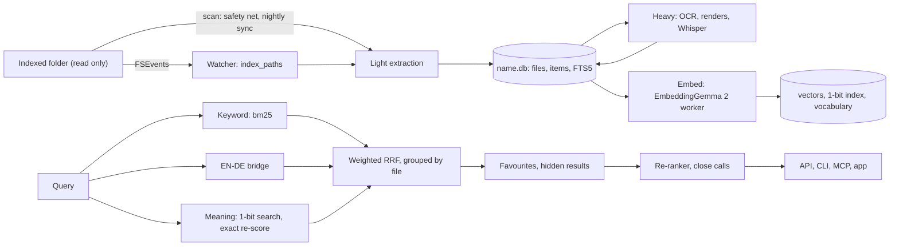

# How MySearch works

This is for engineers who want to read, run or change MySearch. Each claim names the file that implements it. For installation see [INSTALL.md](INSTALL.md); for the user's view see the [README](../README.md). Where the code is unclear, this document leaves the point out.

## 1. Architecture

| Component | Where | Role |
|---|---|---|
| Daemon | `mse/server.py` (`mse serve`) | HTTP API, web UI (`mse/ui/`), MCP over HTTP, job queue. Standard-library HTTP on 127.0.0.1, port 8737. Loads no model. |
| Model workers | `mse/worker.py`, via `mse/embedder.py` | Separate processes for embeddings, Whisper, re-ranking and Ask. |
| Native helper | `helper/msehelper.swift` | PDF text and renders, Vision OCR, FSEvents, file-name crawl, Keychain. One JSON reply per command. |
| Mac app | `app/` | Native app on the HTTP API. `MySearch --daemon` supervises the service. |
| CLI | `mse/cli.py` | Search, file names, Ask, folders, evaluation, service control. |
| MCP server | `mse/mcp.py` | JSON-RPC 2.0 for agents: stdio (`mse mcp`) and `POST /mcp`. Ten tools, three kinds of resource, three prompts (section 8). |
| Raycast | `integrations/raycast/` | Search and status, using the port and token in `config.json`. |
| LaunchAgent | `mse/service.py` | Label `com.mysearch.daemon`. Starts at login, restarts on exit. |

**Access.** The Host header must name `127.0.0.1`, `localhost` or `[::1]` on the service port. `/api/*`, `/mcp` and the web pages (`/`, `/settings…`, `/?mini=1`) need the token (the `X-MSE-Token` header or a `t` query parameter), and any Origin must be local. A page without the token gets a 401 note. `/static/` is public and holds no token. The token is `secrets.token_urlsafe(24)`, stored in `config.json`. SECURITY.md has the full model.

**Processes.** A worker reads one JSON object per line on stdin and replies on stdout. `mse/embedder.py` starts it on first use and stops it after 10 idle minutes. The Ask worker stops after 5 (`ask.idle_unload_min`), or at once when Ask is switched off.

**Supervision.** With MySearch.app installed, the LaunchAgent runs `MySearch --daemon` (`app/Daemon.swift`). That supervisor starts the Python service as a child, forwards SIGTERM and SIGINT so the queue is saved, and exits with the child's status. The plist sets `HF_HUB_OFFLINE=1`, so the service cannot download models.

## 2. Indexing

| Stage | Function | Output | When |
|---|---|---|---|
| Light | `extract.light()` in `indexer.scan()` | Text, Office, mail, PDF text layer, archive names | Every scan |
| Heavy | `extract.heavy()` in `indexer.heavy()` | OCR, page renders, media segments, transcripts | Nightly; live for up to 5 new files on AC power |
| Embed | `indexer.embed()` | Vectors for text, titles, pictures, pages, video, audio | After each stage; live for up to 400 pending text items |

A sync (`mse/jobs.py`) runs scan, heavy document work, embed, heavy audio and video, and embed again. At night it adds an FTS optimise. Every sync ends by building the folder's vocabulary (`indexer.build_vocab()`), which feeds the EN↔DE bridge. A live change indexes only the files that changed.

**Document facts** (`mse/docmeta.py`). After a file's light extraction, in full mode only, `docmeta.store_light()` classifies it and extracts its date, amount, counterparty and reference from the first 20,000 characters (the first 8,000 decide the type) and upserts one `doc_meta` row. It never raises: a classifier problem cannot cost a scan its transaction. A file that is metadata-only, failed, ineligible (source code, data files) or waiting for OCR (scans, images) holds no row. A throttled backfill at the end of every scan (`DOCMETA_BACKFILL`, 500 files; 20,000 in the night run) fills in files without a row, rows with an older `docmeta.EXTRACTOR_VERSION`, and files whose OCR text is newer than their row; a text-less file gets a stub row (`doctype` NULL) so it is not read again. `mse docs reindex <folder>` redoes all of it in batches of 200, one write lock at a time. The rules are weighted keyword rules in English and German over the title lines, the body, the file and folder names and the layout (a totals line, a signature block, a run of dated money lines), folded to ASCII with `ä/ae`, `ü/ue` ... equal. The confidence is `(1 - exp(-s1/6)) * (0.35 + 0.65 * (s1 - s2)/s1)` of the best and second-best score; below 0.5 the type is `other`; text and Markdown notes also need a strong keyword of the type itself. Numbers are read as German (`1.234,56`) or English (`1,234.56`) by their separators; the amount is the labelled gross total (not the subtotal, VAT, paid or change lines), else for invoices, receipts and quotes the largest amount that carries a currency. Dates prefer labels (invoice date, Rechnungsdatum ...) and skip due, delivery, validity and birth dates; nothing is later than today. Limits: the counterparty is whoever is printed in the letterhead or the From name, which for an outgoing invoice is you (`docmeta.own_names` skips your own names); the indexer stores text in chunks of about 1,100 characters, and long paragraphs lose their line breaks, so every rule works on a label and its value close together. Embedding similarity to `docmeta.PROTOTYPES` is left as a hook (`classify(prior=...)`). Add your country's legal forms and extra keywords in `config.json` (`docmeta.extra_org_suffixes`, `docmeta.extra_keywords`).

**Formats** (`mse/extract.py`). Text and code (Markdown split by heading), Word and RTF via macOS `textutil`, spreadsheets sheet by sheet, OpenDocument, iWork, mail (`.eml`, mbox), PDF text layers, images, audio, video, and archive member names. Other files are indexed by name only. Files over `max_file_mb` (200 by default), or matching a `metadata_only` pattern, are in *meta* mode: name only, never opened or hashed.

**OCR.** A PDF page is scanned when it has under 40 non-space characters, or under 600 with text covering under 5% of the page. Scanned pages are OCRed. The `pdf_pages` policy chooses candidate pages for a page image (`smart`: page 1 and the scanned pages, up to 30; `all`; `off`), and `media.pdf_page_images` then decides which of them are rendered and embedded (below). Vision renders at about 300 dpi (long side at most 4,096 px), keeps observations with confidence 0.3 or more, and detects the language per image unless `media.ocr_langs` is set.

**Lighter heavy work** (`config.DEFAULTS["media"]`, `indexer._media`, `extract.page_images`, `extract.image_ocr_mode`). Four rules with a global default in `config.json` → `media` and a per-folder override in the folder's `media` (`null` inherits). The decision is taken when a file is light-extracted and stored in its heavy spec, so a file already indexed is never re-processed; the rules apply to new and changed files. Measured per unit on an M4 Pro:

| Key | Values (default first) | What it changes | Measured rationale |
|---|---|---|---|
| `media.pdf_page_images` | `scanned_only` · `all` · `none` | Which of the `pdf_pages` candidates get a page image and an image embedding. `scanned_only`: only pages the OCR test flagged, so a PDF with a text layer renders no page image (its text and thumbnail stay). `all`: the old behaviour (page 1 and the scanned pages). `none`: no page image | A text PDF cost 0.39 s, of which the page-1 image embed was 0.27 s, for a picture of text the text layer already holds |
| `media.scan_page_images` | `true` · `false` | Whether a scanned page gets a page-image embedding besides its OCR text. `false`: OCR text only | A scanned page costs 0.65 s: 0.35 s OCR + 0.27 s page-image embed |
| `media.image_ocr` | `auto` · `always` · `never` | `auto`: the helper's `probe` (Vision `.fast`, no language correction, the full OCR's minimum text height, on a copy at most `extract.PROBE_MAX_PX` = 768 px wide) runs first, and the full `.accurate` OCR only when it read at least one line of two or more letters or digits with confidence 0.5 or more; the picture's own embedding is unchanged. An older helper without `probe` means OCR as before (`always`). Text too small to be seen at 768 px is not OCRed | A picture costs 0.58 s: OCR ran on every picture, text or not. The probe costs about 0.06 s; at 512 px it missed a 26 px caption in a 1600 px picture, at 768 px it sees it |
| `media.video_mode` | `segments` · `poster` | `segments`: the old behaviour, one 1 fps clip embed per 30 s. `poster`: one frame at 10 % of the duration, embedded as a picture (an image item carrying its time), plus the transcript passages; audio and Whisper are unchanged | Video costs 12 s per minute: 8.6 s segment-image embeddings + 2.9 s Whisper. `poster` removes the 8.6 s; its search quality is untested, so `segments` stays the default |

Helper commands per file, after: a text PDF `pdf` (light) and `render --pages 1 --max-px 420` (thumbnail); a scanned PDF `pdf`, `ocr --pages …`, `render --pages <scanned> --max-px 1280` and the thumbnail; a picture `image` (embedding copy and thumbnail), `probe`, and `ocr` only when the probe found text; a video no helper command (ffmpeg and Whisper). Before: a text PDF also had `render --pages 1 --max-px 1280` and a page-image embed; a picture always had `ocr`. `mse sync --reocr` OCRs a picture again whatever `image_ocr` says; `--retranscribe` follows `video_mode`.

**Idle gate** (`indexer._wait_for_heavy_work`, `config.DEFAULTS["indexing"]["priority"]`). Outside a sync, the heavy pass asks `jobs.heavy_work_allowed(priority)` before each file and the embed loop before each model batch (cached vectors need no gate). `indexing.priority`: `low` = AC power and 60 s without input; `balanced` (default) = 5 s without input and (AC power or 60 s idle); `always` = never asked. A refusal pauses the stage in steps of at most 2 s, re-checking each time, cancellable at every step; the reason (`user_active`, `on_battery`, `disabled`) is shown in `/api/index/progress` → `paused` and by `mse status` as `paused (user active)`. "Sync now" and the night run (`jobs.py`, kind `sync`) and `mse index <file>` (`indexer.index_one`) pass `always` and are never paused; the periodic scan's live embed, the live heavy work after a file event and `--kind embed` jobs follow the setting. A tree whose `jobs.py` has no `heavy_work_allowed` is never paused.

**Transcripts.** `ffmpeg` writes a 16 kHz mono WAV and cuts silences of at least 8 seconds below −40 dB, but only when the cut saves at least 60 seconds and 20%. Whisper large-v3-turbo runs once per file, with no-speech, log-probability and compression thresholds of 0.6, −1.0 and 2.4. A line repeated three times in a row is kept once. Tags, subtitle credits and sign-offs the model judged unlikely to be speech are dropped. Passages run 30 to 60 seconds. Only the first `max_media_minutes` (90 by default) are processed.

**Incremental scans** (`mse/indexer.py`).
- A file whose size, mtime and mode are unchanged is not opened.
- Reads run in two to four threads, each with a 420-second limit. Only the scanning thread writes, committing every 200 files or 2 seconds.
- A vanished row and a new file are one file when extension and size agree and the content hash matches. The row is re-pointed, keeping its text, OCR and vectors.
- A file that fails three times in a row, with the same mtime and extractor version, is skipped until one of them changes. A marker file lists the files being read, so a killed process gives each of them a strike.
- `EXTRACTOR_VERSION` names extensions whose extraction changed. Their files are re-read, 25 per scan or 2,000 at night.
- A folder the walk cannot read keeps its rows. A missing root removes nothing.

**Live updates and the night run.** `mse/watcher.py` flushes 3 seconds after the last FSEvents event, and at most 45 seconds after the first. More than 500 paths in one flush, or dropped events, trigger a full scan. A scan every 60 minutes is the safety net. The nightly sync starts at 02:30 inside a 5-hour window, on AC power by default. A run due outside the window waits for 20 minutes without input (`mse/jobs.py`). In the night run, embedding runs at nice 10 and the FTS index is optimised.

**Progress.** `GET /api/index/progress` and `mse status` report each folder's stage, counts, rate and errors (`mse/progress.py`).

## 3. Storage

Each folder has `collections/<name>.db`, an SQLite database in WAL mode with one write lock per folder (`mse/store.py`).

| Table | Holds |
|---|---|
| `files` | One row per file: path, kind, size, mtime, mode (`full` or `meta`), title, date, `docid` (the `#docid`), hash, inode, extractor version |
| `items` | Searchable pieces (text, OCR, transcript, page, picture, segment), with page, time range and `embedded` flag |
| `fts` | FTS5 over name, heading and text. Diacritic-insensitive, with a prefix index |
| `vectors`, `vbin` | float16 vectors for exact re-scoring; a sqlite-vec index of 768-bit sign vectors |
| `vcache`, `vocab`, `vvocab` | Prompt-to-vector cache; vocabulary terms and their embeddings |
| `doc_meta` | One row per file (schema 4): `doctype`, `confidence`, `doc_date`, `amount`, `currency`, `counterparty`, `reference`, `lang`, `extractor_version`, `extracted_at`; indexes on `doctype` and `doc_date`. `doctype` NULL means looked at, nothing to classify |
| `failures`, `meta` | Strike counts; timestamps and resume checkpoints |

Search asks the 1-bit index for 16 times the list size, then re-scores those candidates exactly. With 2,000 or fewer allowed files it scores their vectors exactly, with no first pass (`EXACT_FILTER_FILES`). Other state lives in `~/Library/Application Support/MySearch/` (mode 0700). Removing a folder moves its database to `trash/`; nothing is deleted.

## 4. Search and ranking (`mse/search.py`)

**Parsing.** Known `key:value` filters (`config.FILTER_KEYS`) and quoted phrases are taken out. Plain-language dates ("last month", "invoices from March 2025") become `after` and `before` on the file's date. `in:` takes a path, or a folder, group or alias name.

**Document filters** (`mse/docmeta.py`, `search.meta_filter`). `type:` (and its unambiguous twin `doctype:`) takes a document type (`invoice`, `receipt`, `bank_statement`, `contract`, `letter`, `quote`, `reminder`, `payslip`, `tax_document`; `Rechnung`, `Quittung`, `Kontoauszug` ... work too) next to the file kinds and extensions it always took, comma separated; `type:other` stays the file kind, `doctype:other` is the document type. `amount:>500` `>=` `<` `<=` `100..200` `119` (repeated: all must hold), `currency:EUR`, `party:acme` (case and accent insensitive substring), `docdate:2025` `2025-03` `2025-03-14` `2025-01..2025-06` `2025-01-01..` `..2025-06` (a month-only date such as a payslip's counts as the first of the month). Repeated `type`, `currency`, `party`, `docdate` mean any of. A malformed value is a `ValueError` (HTTP 400). The filters are applied inside retrieval like the others, by joining `doc_meta` only when one of them is present; a database without the table matches nothing. A query with such a filter and no words is not ranked: the matching files come newest document date first (`browse: true`, `total` = all matches, all scores alike so the relevance floor never drops older ones). A row without the `dm_*` columns (the favourites code loads plain `files` rows) cannot be proven to match and is not injected.

**Plain language** (`docmeta.nl_map`). A comparator (*over, above, more than, greater than, exceeding, at least, minimum, under, below, less than, at most, up to, between ... and*; *über, mehr als, mindestens, unter, weniger als, höchstens, zwischen ... und*) plus a number maps to `amount:`, a currency next to it to `currency:`, and a document-type word (*invoices, receipts, contracts, Rechnungen ...*) to `type:`. It fires only when the number has a currency or the query names a kind of document, never for a year-like number without a currency or a number with a unit (`pages`, `kg`, `degrees` ...), never with quoted phrases or an explicit `amount:`, and only when nothing but filler words (*show me, all, the, of, in ...*) is left once the amount, the kind of document and a date are taken out: Ask and the learning loop send whole questions through `search.parse`, and a question must stay an ordinary search. When a document filter is present, a plain-language date maps to `docdate:`; otherwise it is `after`/`before` as before. What is left of the query after the filters are taken out is empty or filler, which is dropped (a filters-only query lists documents).

**Three lists**, merged by weighted reciprocal-rank fusion: each hit adds `weight / (60 + rank + 1)`.

| List | Method | Weight |
|---|---|---|
| keyword | FTS5 `bm25` (name ×4, heading ×2, text ×1); words of four letters or more match as prefixes | 0.6 |
| translated | Query embedding matched to the folder's vocabulary (cosine ≥ 0.62, at most five terms), then searched by keyword | 0.6 |
| meaning | Query vector against text (1.0), titles (0.55), pictures and pages (0.75), audio (0.6) | as shown |

Queries use the prefix `task: search result | query: `. Documents use `title: … | text: …` (`mse/embedder.py`). The top keyword and text hits get a 0.004 bonus. Filters apply inside retrieval.

**Documents.** Files sharing a long, specific name (18 or more letters and digits after folding, not a generic overview name), or else a content hash, form one document, and the best-ranked original is shown. A file's score is its best item, plus 0.3 of the second, plus 0.1 of the third. Overview files (SUMMARY, README, INDEX, TODO and similar) are multiplied by `hub_penalty`, 0.6.

**Favourites** (`mse/feedback.py`). *Best* files are pinned in the order marked, and *hide* files are removed. For a query with embedding cosine ≥ 0.90 to a stored one, *best* files already in the results get a bonus of 15 to 50% of the top score. Pinned results are never re-ranked.

**Re-ranker** (`mse/rerank.py`). It runs only on close calls, when the second result scores at least 0.8 times the first. It re-orders the top 10 with Qwen3-Reranker-0.6B, which answers yes or no for each query and document (name plus up to two passages, cut to 128 tokens). Its order is fused with the retrieval order by rank, with retrieval weighted 0.75, so it mostly breaks ties. The CLI re-ranks unless `--fast` is given. MCP `precise` defaults to true. `/api/search` re-ranks only with `precise=1`. The app and web UI show the instant list, then request `precise=1` and replace it if the order changes.

**Presentation.** `relevance` runs from 0 to 100 against the top score. Diacritics fold on both sides, so `Lösung` matches `Losung`. `files.doc_date` (the `date` of a result, and what `after:`/`before:` compare) is the date in the file's path, else its modification time. The date *inside* the document is `meta.doc_date` (`docdate:`). Every result carries `meta` (`doctype`, `confidence`, `doc_date`, `amount`, `currency`, `counterparty`, `reference`, or `null`) and the facets include a `doctype` count.

## 5. Learning loop

**Tuning** (`mse/learn.py`, `mse/evaluate.py`). After each night sync, `learn` writes known-item questions from up to 150 recent files per folder, keeping those that at most two documents match. A grid over fusion weights, hub penalty, and re-ranker gate and weight is scored on the gold sets in `eval/`, the favourites and these questions (hit@1, hit@3, hit@10, MRR@10). A setting is applied only if weighted MRR rises by at least 0.01, no hand-written gold set loses more than 0.01 MRR or a rank-1 hit, and favourites do not get worse. `mse tune --rollback` undoes a change.

**Re-ranker fine-tune** (`mse/finetune.py`). It starts with at least 300 favourite examples and 100 queries. Each favourite is the positive; the hard negatives are the documents ranked just above and below it. Queries split 80/20 by a stable hash, and gold-set questions are never used. QLoRA through mlx-lm trains rank-8 adapters on the query and value projections of the last 16 layers. Promotion needs favourite MRR up by 0.02 or more, no gold set down by more than 0.01 MRR, and median re-rank time up by at most 10%. A `CURRENT` file selects the adapter, so rollback only moves that pointer.

## 6. Whole-Mac file names (`mse/macindex.py`, `mse/filequery.py`)

**Crawl and index.** The helper's `crawl` walks breadth first with `getattrlistbulk`. It never follows symbolic links, stays on the boot volume and skips iCloud placeholder folders. Python checks each entry against the privacy rules before storing it. `macindex.db` (schema 2) holds a `files` table; `name_tri`, an FTS5 `trigram` table over the folded names with `detail=none` and `columnsize=0` (it records which 3-letter pieces a name contains and nothing else: about a third of the size of a positional index); `tri_stats`, how many names contain each piece (a hint for the query plan, see below); and a `vocab` table of name tokens for typo candidates. The first crawl starts 20 s after the service; rescans run every 24 h. FSEvents keeps rows current: the helper is started with a 50 ms latency and `--no-defer` (the first change after a quiet spell is reported at once), the service applies changes event-driven, 10 ms after the first event of a burst and at most every 50 ms or four times the last apply, whichever is longer. On a 2 M-name index a created file is searchable about 30 ms later (an older helper without `watch_nodefer`: about 65 ms; before: about 420 ms).

**Query plan.** A word of three letters or more asks `name_tri` for the names that contain its three rarest pieces (`tri_stats` says which are rare), looks at the first 4000 names in index order that really contain the word (`instr()` runs inside that window, so the window holds exactly the names the first, positional index would have returned) and lets the outer query filter them, order them by the word's tier, depth and recency and keep the best few hundred. Python scores those. Words of one or two letters scan the name index by prefix. Typo candidates are an OR of such plans, three pieces per candidate. The counts are only hints: a stale or missing count changes which pieces are asked first and never what comes back. A pattern with no literal text (`re:^.{3}$`, `??*.t?t`) reads names in filter order, two columns at a time in chunks of 2000, and stops at enough matches or after `mac_index.regex_budget_ms` (150): the response then carries `partial: true`.

**Upgrade from the first index (schema 1).** The service notices a schema-1 database at start and replaces its positional index in a thread of its own. The old table keeps answering searches the whole time (readers are not blocked by the writer). The new one is built in chunks of 50 000 rows by the thread that holds the write lock, so no row can change underneath it; it is merged into one segment, `tri_stats` is counted, and one transaction then swaps the triggers and the schema flag. A crash before that leaves schema 1 and a half-built table that the next start drops and rebuilds. The old table is dropped a minute after the switch (a search that still chose it retries on the new one); its pages go to the free list, so the file does not shrink by itself. Progress: `GET /api/files/status` -> `name_index.upgrade` (`state`, `phase`, `fraction`, `elapsed_s`). Writers wait during the build (about 6 s for two million names on an M4 Pro); changes from FSEvents queue in memory meanwhile and are applied after.

**Pages.** The candidates and their order are planned for a window of `max(offset + limit, 200)` rows, so `limit=50` followed by `offset=50&limit=150` returns exactly what `limit=200` does. `offset` counts rows the privacy gate lets through. A response to a request that has `limit` or `offset` also carries `offset`, `limit`, `has_more` and `next_offset`.

**Never indexed.** Credential and key stores (`~/.ssh`, `~/.gnupg`, keychains), browser profiles, Mail and Messages, system and cache folders, trash and dependency folders. These cannot be configured. Only names and sizes are stored, and `~/Library/` is excluded by default. The MCP server has no tool for this index, and the CLI refuses it under `MSE_LOCK`.

**Query language** (full text at the top of `mse/filequery.py`):

| Query | Meaning |
|---|---|
| `invoice acme` | Every word appears in the name |
| `^prefix`, `suffix$`, `^whole$` | Starts with, ends with, or is the whole name |
| `Report`, `iPhone` | A word with a capital and a small letter is matched with its case (smart case); `report` and `REPORT` match any case |
| `*.pdf`, `report-*.docx`, `**/invoices/*`, `src/**/*.py` | Globs: `*.pdf` is `ext:pdf`; a glob without `/` matches the whole name; one with `/` the whole path (`**/` = any folders) |
| `ext:pdf,docx`, `type:image`, `!ext:tmp`, `!*.log`, `!term` | Extensions, kinds, exclusions |
| `size:>5mb`, `mtime:<7d` | Size; modified within 7 days |
| `path:work/notes`, `re:^IMG_\d+` | Path contains text; regular expression on the name |
| `in:~/Documents`, `in:work` | Under a folder, or a MySearch folder or group |

**Typos and ranking.** A word of five or more letters forgives one edit: an insertion, deletion, substitution or swapped neighbours. A four-letter word forgives a swap only. A word matched with its case gets no typo tolerance. Typo candidates come from `vocab` and are searched only when literal results fall short of the limit; they rank last. Ranking is exact name, prefix, word boundary, substring, typo, then coverage, recency and depth. fff's weights are applied on top: a name that is the query gets +40 %, a query inside the name +16 % (at most 30 points); both increase with the score, so name matches keep their order among themselves, and they are what puts a name match above a folder-path match (`mac_index.match_folder_names`, off by default: a word absent from the name may be found in the folder path when two or more words come up short; such a row ranks below every name match).

**Opened files and ignore files.** `POST /api/files/opened {path, query?}` records an open in `frecency.db` next to the index: keyed hashes of the path and of the normalised query, counts, a score that halves every 14 days, capped at 4000 files and 8000 query/file pairs; no path or query text is stored, and the index can be deleted without losing it. A recorded file gains up to 40 points; the file opened most for exactly that query gets 1000 and is offered even when the plan's window did not reach it (its id is only a hint: the row at that id must still hash to the stored path). Only paths the search itself could show are recorded, and a boost only reorders rows that passed the privacy gate and the query's filters. `mac_index.frecency` switches it off. `mac_index.respect_gitignore` (off by default) leaves out what the `.gitignore` / `.ignore` files of the repository around a result ignore (`mse/gitignore.py`: a matcher with no regular expressions and fixed bounds, reading only folders that passed the privacy gate).

## 7. Ask (`mse/ask.py`, `mse/cloud.py`, `mse/providers.py`)

Ask is **off by default**. While it is off, nothing is called or loaded.

1. **Rewrite.** A follow-up becomes a standalone search question: by the cloud model (1.5-second budget) when the answer goes to the cloud, otherwise by the local model (at most 40 tokens), or by adding earlier key terms.
2. **Passages.** The precise search runs over the scope. Each top document contributes its best chunk, and spare budget adds second chunks: at most 8 passages, about 3,000 tokens, 1,200 characters each. Metadata-only files never contribute.
3. **Answer.** The model answers in at most five sentences, citing each claim as `[n]`. Citations that point to no passage are removed. If the passages hold no answer, the model replies with one fixed sentence, which is recognised as not found.

| Route | Answered by |
|---|---|
| `cloud` (default) | The chosen cloud model. An error if none is reachable, unless `local_fallback` is on |
| `local` | Qwen3-4B-Instruct-2507, 4-bit MLX. Nothing leaves the Mac |
| Folder with `ask_cloud: false` | Local, whatever the route |

Providers: `anthropic` (Claude API) and custom OpenAI-compatible endpoints (Chat Completions or Responses; fields `key_file`, `training_models`, `auto_models`, see the README). A key comes from the Keychain, else the provider's `key_file`, read when a call needs it. Reachability is a TCP connect (1.5 s timeout, cached 60 s), never an API call. Models matched by a provider's `training_models` patterns may train on inputs, so they need a one-time confirmation before they answer.

**What leaves the Mac.** With `cloud_redact` on (the default), passages and earlier turns are masked before the call, and `done.redacted` counts the masks. The question is sent as typed. Keys travel only in a request header, over https or to loopback, and redirects are refused.

## 8. Privacy and safety

| Control | Where | Effect |
|---|---|---|
| Read-only indexing | `mse/indexer.py` | The indexer and daemon never write inside an indexed folder. Writes happen only on request (`mse agents install`, app file operations and colour tags) |
| Data folder | `mse/paths.py` | Mode 0700 |
| Localhost only | `mse/server.py` | 127.0.0.1 only; Host and Origin checks; token (constant-time compare) on `/api/*`, `/mcp` and the web pages |
| Metadata-only | `mse/indexer.py` | Name only; never opened or hashed |
| Secret exclusions | `mse/ignore.py` | Env files, keys, certificates, keystores, credential-, secret- and password-named items, SSH and GPG folders. Never read or listed; not configurable |
| Default exclusions | `mse/ignore.py` | Hidden folders, build and dependency output, caches, lock and temp files, agent configs |
| Document facts | `mse/docmeta.py` | Derived on this Mac with no model or network; never an IBAN, card, passport, permit, tax or personal ID number or a date of birth in any field (labelled birth and validity dates are skipped, a reference is checked against the redaction patterns and its context, identity documents get no fields, payslips and tax documents no reference); removed with the file, or when it turns metadata-only |
| Redaction | `mse/redact.py` | National ID numbers for 20+ countries (`NATIONAL_IDS`, one table: a number is masked when its published check passes, or next to its label where the form is ambiguous), passports, residence permits, tax IDs, IBANs, dates of birth and machine-readable zones, masked for agents and piped CLI output; `agents.extra_id_patterns` adds local formats. The app shows everything |
| Keychain | `mse/providers.py`, helper | Keys under service `com.mysearch.provider`, read with UI disabled, cached 10 minutes, never in config, logs or responses |
| MCP lock | `mse/mcp.py` | `MSE_LOCK=1` (stdio only) limits a session to its folder's collection. HTTP `/mcp` takes the token but is not locked |
| Downloads | `mse/setup_models.py` | Public Hugging Face repositories at pinned revisions |

### MCP server (`mse/mcp.py`)

JSON-RPC 2.0 over stdio (`mse mcp`, which talks to the daemon over HTTP) and `POST /mcp` (inside the daemon, no lock). One
module serves both: `LocalClient` calls the search modules directly, `HttpClient` calls `/api/*`.

**Protocol.** `initialize` echoes the client's `protocolVersion` when it is one of `2025-06-18`, `2025-03-26`, `2024-11-05`
and answers `2025-06-18` otherwise. Capabilities: `tools` (`listChanged` false), `resources` (`subscribe` false,
`listChanged` false), `prompts` (`listChanged` false). Anything else, `resources/subscribe` included, is `-32601`.

**Tools.** Names, required arguments and meanings of the original eight are unchanged. All new arguments are optional.

| Tool | Arguments (type) | Notes |
|---|---|---|
| `search` | `query` (string, required), `collection`, `limit` (1-50, default 10), `type`, `after`, `before`, `path`, `include`, `exclude`, `mode` (`hybrid` `keyword` `semantic`), `precise` (default true); **new:** `doctype` (array of `invoice` `receipt` `bank_statement` `contract` `letter` `quote` `reminder` `payslip` `tax_document` `other`), `amount_min`, `amount_max` (number, 0 to 999999999999), `currency` (`^[A-Za-z]{3}$`), `party` (string, at most 120 characters), `docdate_from`, `docdate_to` (`YYYY`, `YYYY-MM`, `YYYY-MM-DD`) | `readOnlyHint` |
| `get` | `ref` (required), `collection`, `page` (integer, at least 1; 0 or less is an error), `max_chars` (default 12000) | `readOnlyHint` |
| `multi_get` `similar` `collections` `ask` | unchanged | `readOnlyHint` |
| `mark_best` `sync` | unchanged | `readOnlyHint` false, `destructiveHint` false |
| `timeline` | `collection`, `type` (array of document types, or one as a string), `from`, `to` (`YYYY`, `YYYY-MM`, `YYYY-MM-DD`; the month counts, `to` is inclusive) | `docmeta.timeline`; `GET /api/docs/timeline?c=&type=&from=&to=` |
| `facets` | `collection`, `type` | `docmeta.facets`; `GET /api/docs/facets?c=&type=` |

*Document filters.* They are validated first (a value in the enum, a three-letter currency, finite amounts from 0 up, `amount_min`
not above `amount_max`, calendar dates with `from` not after `to`, a party without a comma, a double quote, a backslash or a
control character) and then appended to the query, after the lock check and the scope shortcut, as the inline filters of the
query language: `doctype:<kind>` once per kind (alternatives), `amount:>=min` and `amount:<=max` (both must hold, two
decimals), `currency:<CODE>`, `party:<name>` (double-quoted when it holds spaces or an apostrophe) and
`docdate:<from>..<to>` (an open end is left empty; `to` includes its whole period, as `docmeta.parse_docdate` reads it). The
tokens go inside `q` because it is the one parameter both backends pass on: `GET /api/search` drops every key it does not
know. The result is checked with the tokenizer `search.parse` uses (the appended tokens must come out as written), so a
query with an unbalanced quote or a trailing backslash that would swallow a quoted party is refused. With none of the
arguments the query is passed on byte for byte. A negative amount cannot be written in the query language and is refused;
amounts are compared to two decimals.

*Output lines.* A result adds, only when known, `   meta: <kind> · <date> · <amount> <currency> · party <name> · ref <reference>`
(from the `meta` that every search result carries) and `   cite: <title> p.<page>` or `   cite: <title> @ <m:ss | h:mm:ss>`
(the first hit with a page, else the first with a time; the extractor counts pages from 1, so nothing is converted; the title
is `files.title`, else the name, and for a metadata-only file always the name through `redact_path`). Existing lines are
untouched. `get` with a page adds `page N` to the head and a `cite:` line, and says `page N has no extracted text` for an empty
page. `timeline` prints one line per month (count, amounts per currency), `months with no document: ...`, first and last month
and the undated count (at most 240 months, then a note); `facets` prints kinds, top parties, the last 36 months and currencies.

*Masking of new fields.* The whole-text mask (`_agent_safe`) is unchanged. Each new value from a document or from the settings
(a party, a reference, a title, a facet's party, a saved search's name and query) also goes through `_guard`, which follows the
same switch (`agents.redact`; off = unchanged): `redact()`, then IBAN-shaped runs in any case (checked with
`docmeta._iban_like`), Luhn-valid 13-19 digit runs (`docmeta._luhn`) and every token with six or more digits in a row
(`redact._RX_PATH_ID`, the pattern `redact_path` uses) become a mask; a reference that `docmeta._safe_reference` rejects is
masked whole. A bare ID-shaped value is passed by `redact()` and by `_safe_reference`, which is why the last pattern is there.
The cost: a reference with six or more digits in a row (many invoice numbers) is shown as `[id]`. The query that a saved search
repeats in the first line of its results is masked the same way.

**Resources** (`text/plain`; `contents: [{uri, mimeType, text}]`). `resources/list`: `mysearch://collections` and
`mysearch://saved/<id>` for each saved search the session may use. `resources/templates/list`: `mysearch://saved/{id}` and
`mysearch://doc/{docid}`. `resources/read`:

| URI | Content | Errors |
|---|---|---|
| `mysearch://collections` | the `collections` tool's text | `-32002` when a lock has no collection (the message says why) |
| `mysearch://saved/<id>` | name, query and scope (masked), then the results of `call_tool("search")` for it; no scope saved = `collection: all` unlocked | `-32002` when it does not exist or the lock hides it |
| `mysearch://doc/<docid>` | `get`'s text for `#<docid>` (`^[0-9a-f]{8}$`) in the locked collection, else in all | `-32602` for a malformed docid; `-32002` when not found or outside the lock |
| anything else | | `-32002` (`-32602` when `uri` is missing) |

Resources are thin wrappers over `call_tool`, so the lock (`Lock.check`), `_confined` and the masking apply as for the tools;
`/api/saved/<id>/run` is never used. Under `MSE_LOCK=1` a saved search is listed and readable only when its scope is nothing
but the locked collection (`Lock.only_mine` on the scope shortcut in its query, which wins, else its `collection`; no scope
means every collection and is hidden; an unknown name or an `in:<folder>` outside the collection hides it), and a hidden one
answers with the same `-32002` message as one that does not exist.

**Prompts.** `prompts/list` returns `find-document` (`description` required; `type`, `date` optional), `monthly-summary`
(`month` `YYYY-MM` required; `collection` optional) and `missing-receipts` (`year` `YYYY` required; `collection` optional);
`prompts/get` returns `{description, messages: [{role: "user", content: {type: "text", text}}]}` naming the tools to call.
`-32602` for an unknown prompt, a missing or malformed argument, an unknown argument, and, under the lock, a `collection` that
`Lock.only_mine` refuses (the message names the allowed collection).

**Errors.** `-32002` resource not found, `-32602` invalid params, `-32601` method not found, `-32603` internal. A bad tool
argument or a refused scope is a tool result with `isError: true`, as before.

**Import cost.** `mse.mcp` does not import `mse.docmeta` (about 30 ms): the kind list is a literal that
`tests/test_mcp_schema.py` keeps equal to `docmeta.DOCTYPES`, and `docmeta` is loaded on the first call that needs it.

## 9. Performance

Measured on an M4 Pro, on a private test folder of a few hundred documents in English and German. Search quality: 28 questions run with `mse eval` on a gold set that is not published.

| Setting | Right file first | In top 3 | In top 10 | MRR |
|---|---|---|---|---|
| First version (equal weights) | 0.68 | 0.89 | 0.96 | 0.81 |
| Current default | 0.82 | 0.96 | 1.00 | 0.90 |
| Meaning only | 0.82 | 0.93 | 0.96 | 0.87 |
| Keywords only | 0.57 | 0.64 | 0.79 | 0.63 |
| Default + re-ranker | 0.89 | 1.00 | 1.00 | 0.95 |

Engine: 8-bit against BF16 embeddings gives cosine 0.9996 and 99.6% identical top 10. The 1-bit search with 16× re-scoring gives 99% identical top 10, about 10× faster. An unchanged folder re-embeds in 6 s instead of 320 s. Live changes show in about 3.6 s. The service uses 50–170 MB, the text model about 0.8 GB and the re-ranker about 0.9 GB while loaded. The re-ranker adds 0.25–0.45 s when it runs.

File-name index, on a synthetic index of 2.0 million entries with realistic names (M4 Pro, warm cache, not a live disk): about 5 ms p50 in process at `limit` 50, 9.4 ms p50 end to end at `limit` 200, and about 1 GB on disk.

## 10. Models

Weights are never shipped. `mse setup models` downloads them (manifest in `mse/setup_models.py`; see [INSTALL.md](INSTALL.md)).

| Role | Model | Size | Licence | Loaded when |
|---|---|---|---|---|
| Embeddings, all media | Google EmbeddingGemma 2, 8-bit MLX | 1.2 GB | Apache-2.0 | Searching; night run |
| Speech to text | Whisper large-v3-turbo, 8-bit MLX | 829 MB | MIT (OpenAI's original); the MLX repack's card says Apache-2.0 | Night run, new recordings |
| Re-ranking | Qwen3-Reranker-0.6B, 8-bit MLX | 615 MB | Apache-2.0 | Close calls |
| Ask, local | Qwen3-4B-Instruct-2507, 4-bit MLX | 2.1 GB | Apache-2.0 | Only when Ask answers locally |
| Ask, cloud | Claude by default, or another provider | none | The provider's terms | Cloud route, when reachable |

The re-ranker's 8-bit folder and the optional text-only embedding copy are not installed automatically. Sizes are the README's figures.

## 11. Source map

| File | Role |
|---|---|
| `mse/server.py`, `mse/jobs.py` | Daemon and API; queue, scheduler, sync stages |
| `mse/indexer.py`, `mse/extract.py`, `mse/store.py` | Scan, heavy work, embedding; formats; schema |
| `mse/search.py`, `mse/rerank.py`, `mse/feedback.py` | Retrieval and grouping; re-ranker; favourites |
| `mse/learn.py`, `mse/evaluate.py`, `mse/finetune.py` | Quality, tuning, re-ranker fine-tune |
| `mse/macindex.py`, `mse/filequery.py` | Whole-Mac name index and query language |
| `mse/wholedisk.py` | Whole-disk content index: labels, first pages and first kilobytes of every file under the roots, described in the background through `msehelper describe` ([docs/WHOLE_DISK.md](WHOLE_DISK.md)) |
| `mse/ask.py`, `mse/cloud.py`, `mse/providers.py` | Ask; cloud clients; keys |
| `mse/docmeta.py` | Document type, date, amount, counterparty, reference; facets, timeline, backfill |
| `mse/redact.py`, `mse/ignore.py`, `mse/mcp.py` | Masking and exclusions; MCP and folder lock |
| `mse/watcher.py`, `mse/embedder.py`, `mse/worker.py` | Live updates; model workers |
| `mse/cli.py`, `mse/service.py`, `mse/config.py` | Command line; LaunchAgent; settings |
| `helper/msehelper.swift`, `app/` | Native helper; Mac app and supervisor |
